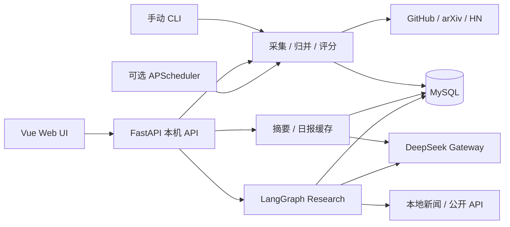
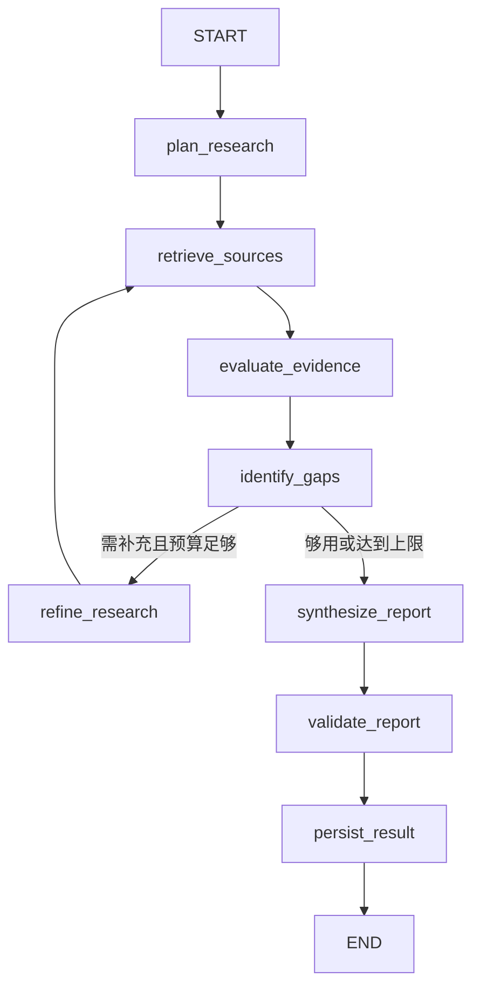

# AIPulse

**本地优先、来源可追溯的 AI 新闻与研究工作台。**

真实资讯 → 去重归并与规则评分 → 中文摘要缓存 → 每日情报 → LangGraph 有界研究。

面向个人开发与学习。当前支持本机单 worker，不提供公网认证、多租户隔离或生产高可用承诺。

## 当前验证状态

| 能力 | 验证范围 |
| --- | --- |
| GitHub Releases / arXiv / Hacker News | 已真实采集、归并、入库、评分；支持 CLI、手动 API、可选 APScheduler |
| 新闻 / 摘要缓存 | 真实 MySQL GET 与前端联调通过，中文摘要曾通过真实模型生成并缓存 |
| 每日简报 | 2026-10-17 的 v2 日报已真实生成，入选 3 个事件，持久化与缓存 GET 通过 |
| Deep Research | 已真实执行任务并保存证据、日志及 failed / partial 结果；v6 报告契约仅通过离线验证，完整成功报告质量尚未真实验收 |
| Vue Web UI | 总览、新闻、日报、研究工作台，桌面/移动布局与只读深链接验证通过 |

最近一次真实研究因 `report_schema_mismatch` **失败**，未发生截断；当时没有保存字段级违规信息，不能还原具体违规字段。v6 增加了安全诊断与结构说明，尚未进行新的真实模型验证。页面保留实际状态，不将离线测试等同于成功研究。

## 界面与展示材料

Vue UI V2 提供总览、新闻、日报和研究工作台，支持桌面与移动端。真实新闻截图涉及外部内容展示权，本次公开快照暂不分发；本地原件保留。仓库不会用假截图冒充真实验收。

## 功能与技术栈

- 三源采集有数量、超时与分页上限；来源独立失败，唯一约束 / UPSERT 保证幂等。
- 规则分类与重要性评分；日报独立判断 AI 相关性，不篡改重要性分数。
- 摘要 JSON + Pydantic 校验，按内容指纹、模型、Prompt 版本缓存，来源 URL 后端控制。
- Asia/Shanghai 单日日报，最多 5 个事件、整份最多一次模型调用；GET 永不生成。
- LangGraph 多节点研究、有限补充检索、证据编号与逐字引文校验、失败用量统计和取消终态。
- 任务、证据、日志、报告持久化；前端刷新恢复查询，有界 GET 轮询不会重新创建任务。

**后端**：Python 3.11、FastAPI、MySQL 8、SQLAlchemy 2 AsyncSession、asyncmy、Alembic、APScheduler 3、LangGraph、DeepSeek V4 Pro / OpenAI 兼容 Gateway。

**前端**：Vue 3、TypeScript、Vite、Tailwind CSS、Lucide。**验证**：pytest、Vitest 定向离线检查。

```text
src/aipulse/                 AIPulse 后端及研究实现
src/ollama_deep_researcher/   冻结上游参考源码
frontend/                    Vue 应用、锁文件、离线交互测试
alembic/versions/            0001 基础表 → 0002 评分 → 0003 摘要 → 0004 研究载荷
tests/aipulse/unit/          Mock / Fake 定向检查
docs/                       架构、模块、部署及验收
```

## 架构





研究最多 2 次模型调用、3 轮检索、18 条证据、360 秒。规划 / 报告生成上限 1000 / 6144 Token，合计 7144（输入另计），报告使用 `high` 推理。没有持久化 checkpoint 或自动恢复付费执行；引用匹配不等于独立事实核查。

## 本地运行

完整步骤：[Windows / Conda 部署与排障](docs/15-LOCAL-DEPLOYMENT.md)。**先准备数据库，不要裸跑 `alembic upgrade head`。**

受保护空库入口现支持逐阶段 `0001 → 0002 → 0003 → 0004`，不依赖 Git 分支或作者解释器路径；已有非空数据库会被拒绝。四份迁移保持审核校验值，先备份再人工运行。迁移编排已离线验证，本轮没有在真实空库执行。见[首次部署](docs/15-LOCAL-DEPLOYMENT.md)与[公开快照边界](docs/24-PUBLIC-CANDIDATE.md)。

1. 使用 Conda Python 3.11；Python 依赖见 `pyproject.toml` / `uv.lock`，前端安装使用 `package-lock.json`。
2. 手动复制 `.env.example` 为本地 `.env`，填写自己的密码与密钥。不要覆盖已有 `.env`。
3. 准备 `127.0.0.1:3306/aipulse_db`、`aipulse_app` 和专用迁移账号。使用专用服务账号和交互式迁移口令，不使用个人账号；检查 MySQL 版本、字符集和权限。
4. 启动只读模式：

```powershell
# 在克隆根目录打开 PowerShell；可位于任意普通目录。
$apProject = (Get-Location).Path
conda activate Aipulse
$env:PYTHONPATH = 'src'
$env:AIPULSE_ENABLE_MANUAL_COLLECTION = '0'
$env:AIPULSE_ENABLE_SCHEDULED_COLLECTION = '0'
$env:AIPULSE_ENABLE_AI_SUMMARY = '0'
$env:AIPULSE_ENABLE_DAILY_BRIEF = '0'
$env:AIPULSE_ENABLE_RESEARCH = '0'
$env:AIPULSE_ENABLE_RESEARCH_EXTERNAL = '0'
python -B -m uvicorn aipulse.api.main:app --host 127.0.0.1 --port 8000 --workers 1 --no-proxy-headers
```

另开终端，在同一克隆根目录执行：

```powershell
$apProject = (Get-Location).Path
Set-Location (Join-Path $apProject "frontend")
npm ci
npm run dev
```

打开 [Web 工作台](http://127.0.0.1:5173)、[Swagger](http://127.0.0.1:8000/docs)。前端需要受支持的 Node/npm；新安装缺数据时显示空状态，不载入假新闻。

## 安全与费用

- 全部写入 / 付费 / 定时开关默认关闭，须在 API 启动前设置**进程环境变量**。这些开关不从 `.env` 自动启用。
- 付费接口验证 loopback peer、Host、Origin 与跨站请求；当前无公网认证，不应使用公网隧道或对外代理。
- POST 需主动确认、提交中禁用；超时或受理结果不明时先 GET 查询，禁止自动重试。
- 摘要、日报各最多一次调用，研究最多两次，业务 SDK 重试 0；失败、取消和截断也可能计费。Token 上限不是金额上限，以供应商实际账单为准。
- 外部新闻是不可信数据；不执行其中指令，URL 由后端控制，不默认保存 Prompt、模型原文、推理内容或密钥。不能保证完全消除 Prompt Injection。
- GET 不执行模型、检索或历史状态修复。备份、日志和验收业务数据放项目外。
- 实例锁不跨进程。生产静态部署需同源 `/api` 代理和 SPA 回退；Vite preview 不自带 API 代理。

## 文档与归属

- [架构](docs/06-ARCHITECTURE.md) · [采集](docs/08-MVP-MANUAL-COLLECTION.md) · [Gateway](docs/09-LLM-GATEWAY.md)
- [摘要](docs/10-AI-NEWS-SUMMARY.md) · [日报](docs/12-DAILY-BRIEF-MVP.md) · [研究](docs/13-DEEP-RESEARCH.md) · [前端](docs/14-FRONTEND-MVP.md)
- [部署](docs/15-LOCAL-DEPLOYMENT.md) · [发布快照边界](docs/24-PUBLIC-CANDIDATE.md) · [真实项目介绍](docs/17-PROJECT-PROFILE.md)
- [研究质量](docs/20-DEEP-RESEARCH-QUALITY.md) · [v6 报告契约](docs/22-RESEARCH-REPORT-CONTRACT.md) · [公开候选说明](docs/24-PUBLIC-CANDIDATE.md)
- [上游归属](THIRD_PARTY_NOTICES.md) · [上游 README](docs/UPSTREAM-README.md) · [MIT 许可](LICENSE) · [上游原许可证](docs/UPSTREAM-LICENSE.txt)

维护者：**xuanqiu233**。AIPulse 自主新增代码采用 MIT，`Copyright (c) 2026 xuanqiu233`。冻结的 `langchain-ai/local-deep-researcher` 上游代码保留 `Copyright (c) 2025 Lance Martin` 与原 MIT 许可。第三方代码、依赖和新闻内容的权利边界见归属文档；MIT 不授予新闻数据或品牌权利。早期审计是历史记录，启动以本文和部署文档为准。
