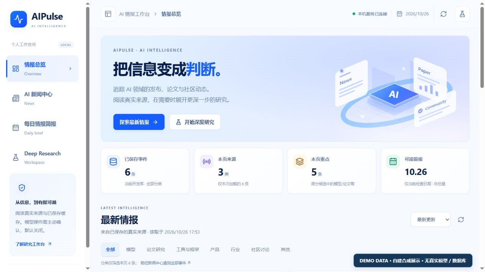
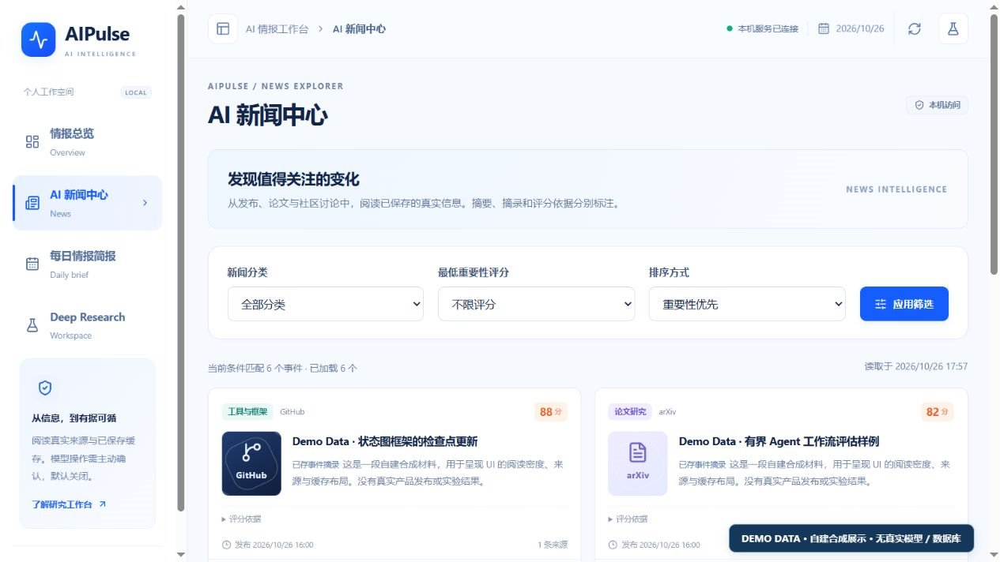
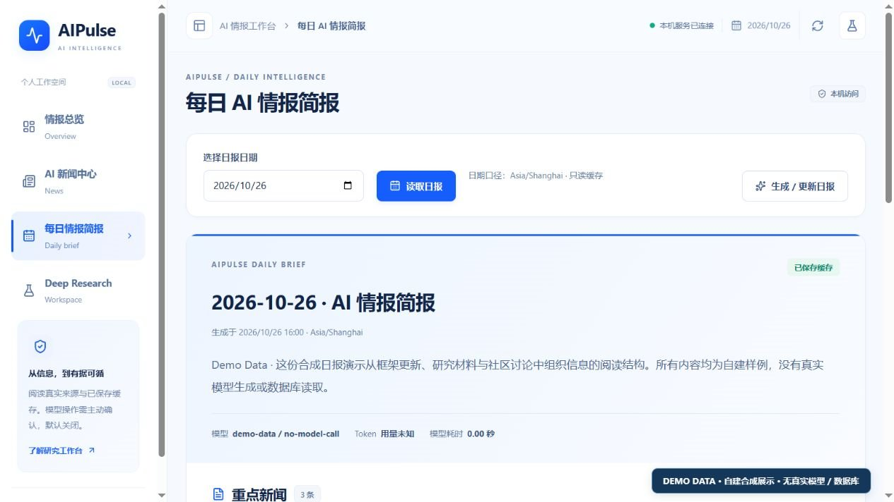
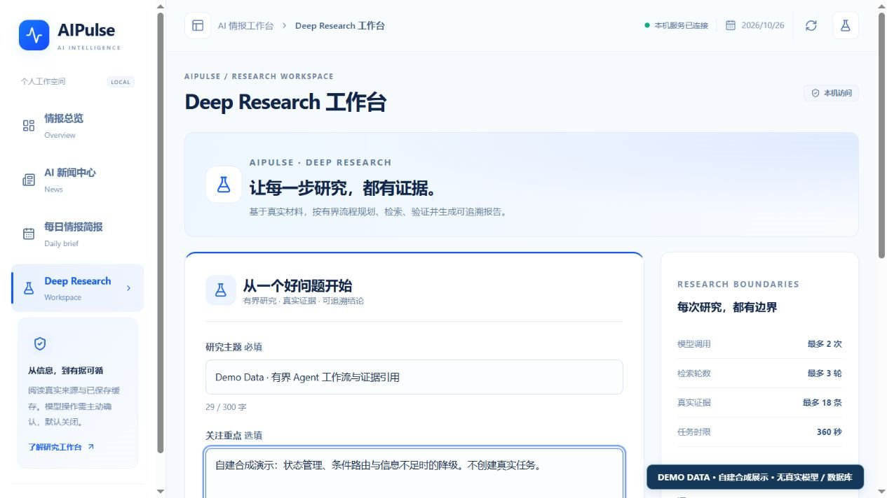
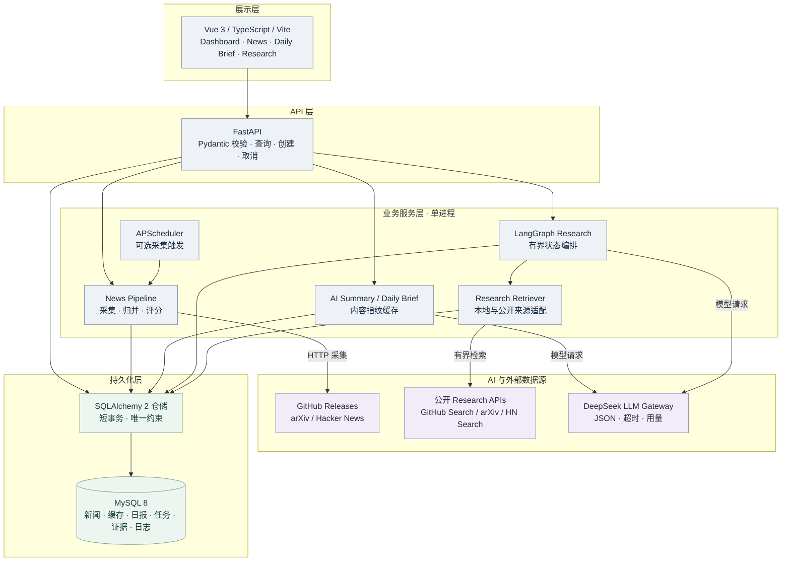
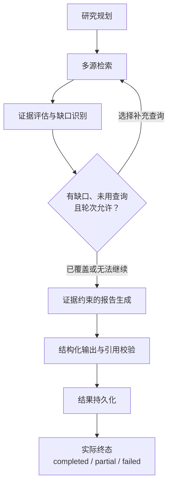

# AIPulse

### AI News Intelligence & Deep Research Platform

把分散的 AI 发布、论文与社区动态，整理成**可查询、可总结、可追溯**的个人情报工作台。

AIPulse 是一个本地优先的全栈应用：Vue 3 提供阅读与研究界面，FastAPI 编排新闻处理和 AI 服务，MySQL 保存业务状态，LangGraph 通过有界检索与严格引用校验组织研究过程。

> **验证边界**：真实新闻采集、中文摘要缓存与每日简报 v2 已通过本地真实验收。Deep Research 已真实运行并保存证据和日志，但 **v6 完整成功报告尚未通过真实模型验收**；当前离线测试不代表模型质量已达标。[研究验证边界](docs/21-RESEARCH-FINAL-RECHECK.md)

## 界面预览

以下是当前 UI V2 的实际浏览器截图，全部使用自建 **Demo Data**，不含真实新闻正文或历史任务数据。截图期间没有连接 MySQL、调用模型或触发采集。



<details>
<summary>查看新闻、日报与研究工作台</summary>

| News · Demo Data | Daily Brief · Demo Data |
| --- | --- |
|  |  |



</details>

截图来源与复现方式见 [展示资源说明](docs/assets/README.md)。研究演示仅提供合成失败任务，不展示成功报告。

## 核心功能

| 能力 | 实现与边界 | 核心源码 |
| --- | --- | --- |
| 多源新闻处理 | GitHub Releases、arXiv、HN；标准化、幂等入库、事件归并与规则评分 | [manual_run.py](src/aipulse/news/manual_run.py)、[service.py](src/aipulse/news/service.py) |
| 中文摘要与日报 | Pydantic 结构化输出、内容指纹缓存；日报独立筛选 AI 相关性，最多 5 个事件、一次模型调用 | [summary.py](src/aipulse/api/summary.py)、[brief.py](src/aipulse/news/brief.py) |
| 有界研究 Agent | StateGraph、缺口补充检索、稳定证据编号、逐项引用校验及安全降级 | [graph.py](src/aipulse/research/graph.py)、[evidence.py](src/aipulse/research/evidence.py) |
| 可追溯工作台 | 新闻过滤与分页、缓存阅读、任务状态轮询、证据定位及取消 | [pages/](frontend/src/pages)、[service.py](src/aipulse/research/service.py) |

## 系统架构

模块化单体；前后端可独立启动，但没有微服务、消息队列或分布式执行器。



箭头表示调用方向。Research Retriever 读取本地新闻并按开关访问固定公开 API；MySQL 保存新闻、摘要缓存、日报、研究任务、证据及节点日志。[详细模块边界与历史设计](docs/06-ARCHITECTURE.md)

## LangGraph Research Workflow



最多 **2 次模型调用、3 轮检索、18 条证据**。规划 / 报告输出上限为 **1000 / 6144 Token**，输入另计；外层执行器设置 **360 秒截止**，超时不会强行生成报告。证据不足可以得到 partial，格式或执行错误可以得到 failed，不以“跑完流程”冒充成功。[真实节点、路由与失败边界](docs/13-DEEP-RESEARCH.md)

## 技术栈

| 层次 | 技术 |
| --- | --- |
| API / 数据 | Python 3.11 · FastAPI · Pydantic v2 · SQLAlchemy 2 AsyncSession · asyncmy |
| 持久化 / 调度 | MySQL 8 · Alembic 0001–0004 · 可选 APScheduler 3 |
| AI / Agent | DeepSeek V4 Pro · OpenAI 兼容 Gateway · LangGraph StateGraph |
| Web / 验证 | Vue 3 · TypeScript · Vite · Tailwind CSS · pytest · Vitest |

## 工程设计亮点

- **事务与费用边界**：网络 / 模型等待不持有数据库事务；生成失败不覆盖已有有效缓存。
- **幂等与缓存**：唯一约束 / UPSERT 处理重复新闻；摘要与日报按实际输入、模型和 Prompt 版本判断缓存有效性。
- **证据优先**：相关性和技术归属分离；标题不能支持超范围技术结论，无效引用逐项剔除，其他有效结论保留。
- **有界执行**：任务槽、轮次、调用次数、Token 与时间共同限制成本；失败调用的已知 usage 仍计入，未知值不补零。
- **安全默认值**：写入、调度及付费功能默认关闭；loopback / Host / Origin 保护、POST 二次确认、日志脱敏和外部输入边界。

以上为 AIPulse 新增业务实现；LangGraph 等框架及冻结上游保留各自归属。[工程验证说明](docs/25-ENGINEERING-QUALITY.md)

## Quick Start

需要 Python 3.11、受支持的 Node/npm 与本机 MySQL。先克隆仓库，在项目根目录打开 PowerShell：

```powershell
conda create -n Aipulse python=3.11
conda activate Aipulse
python -m pip install uv==0.11.15
if (-not $env:CONDA_PREFIX) { throw 'Activate the target Conda environment first' }
$env:UV_PROJECT_ENVIRONMENT = $env:CONDA_PREFIX
uv sync --locked --no-dev --inexact
```

仅在本地 `.env` 不存在时复制 `.env.example`，私下配置应用账号与密钥。**数据库首次准备、备份及受保护初始化必须按 [部署文档](docs/15-LOCAL-DEPLOYMENT.md) 人工执行**，不要裸跑 `alembic upgrade head`。

准备好数据库后，只读启动后端：

```powershell
$env:PYTHONPATH = 'src'
foreach ($feature in @('MANUAL_COLLECTION', 'SCHEDULED_COLLECTION', 'AI_SUMMARY',
                       'DAILY_BRIEF', 'RESEARCH', 'RESEARCH_EXTERNAL')) {
    Set-Item -Path "Env:AIPULSE_ENABLE_$feature" -Value '0'
}
python -B -m uvicorn aipulse.api.main:app --host 127.0.0.1 --port 8000 --workers 1 --no-proxy-headers
```

另开终端，在项目根目录执行：

```powershell
cd frontend
npm ci
npm run dev
```

打开 [Web](http://127.0.0.1:5173) / [Swagger](http://127.0.0.1:8000/docs)。空库显示空状态，应用不会自动导入 Demo Data 或发起付费操作。

## 测试与验证

[Offline CI](.github/workflows/ci.yml) 覆盖 Python 3.11 的固定离线用例，以及前端 test / typecheck / build。测试使用 Fake / Mock，网络守卫阻断真实出站连接；没有 MySQL service、真实密钥、采集或部署步骤。

```powershell
# 在已配置目标环境的终端安装测试依赖
uv sync --locked --group dev --inexact
python .github/scripts/run_offline_tests.py --check-guard
python .github/scripts/run_offline_tests.py
```

本轮只完成本地验证和 CI 静态检查，**尚未推送或运行远程 Actions，不展示通过 Badge**。前端指令、测试范围与实际结果见 [工程质量说明](docs/25-ENGINEERING-QUALITY.md)。

## 已知限制

- 单用户、本机单 worker MVP；没有公网认证、多租户隔离、跨进程互斥或高可用承诺。
- 使用 GET 有界轮询，没有 SSE；持久化结果与日志不等于 LangGraph Checkpointer 或断点恢复。
- 检索只取得已存摘录和公开 API 元数据，不额外抓网页 / PDF 全文；引用匹配不保证语义完全正确，覆盖规则也可能漏判。
- v6 完整成功报告未真实验收；超时、失败、取消及截断也可能收费。所有真实付费操作均需操作者明确启用和确认。
- 没有生产部署、用户量、QPS 或模型准确率等可报告指标；干净机器真实迁移及跨平台安装仍需独立验证。

## License / Third-party Attribution

AIPulse 自主新增代码：**MIT · Copyright (c) 2026 xuanqiu233**。冻结的 `local-deep-researcher` 源码保留 **Copyright (c) 2025 Lance Martin** 及原 MIT 许可，不将其描述为 AIPulse 原创。

[LICENSE](LICENSE) · [第三方声明](THIRD_PARTY_NOTICES.md) · [原上游许可证](docs/UPSTREAM-LICENSE.txt) · [依赖许可](docs/18-DEPENDENCY-LICENSES.md) · [项目介绍](docs/17-PROJECT-PROFILE.md)
