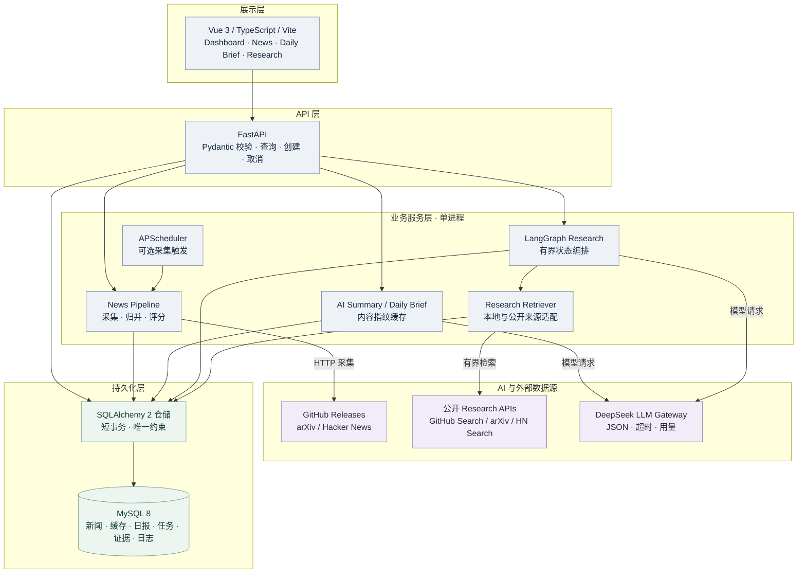

# AIPulse 当前系统架构

2026-10-26 · 源码核对版。AIPulse 是本机优先的模块化单体，不是微服务。本文前半说明已实现边界；原 2026-10-14 设计保存在文末折叠区，**不是当前能力清单**。

## 当前模块与调用方向

| 模块 | 实际入口 / 协作 | 边界 |
| --- | --- | --- |
| Web | `frontend/src/pages/`、统一 API client | Dashboard、News、Brief、Research；GET 轮询，POST 需确认 |
| API | `api/main.py`、news/summary/briefs/research/collect 路由 | Pydantic 参数校验与实例锁；loopback/Host/Origin 保护，非公网认证 |
| 新闻 | `news/manual_run.py` → IngestionService → ScoringService | CLI/API/调度复用一条链路；来源事务先提交，再评分保存 |
| 摘要 / 日报 | `api/summary.py`、`api/briefs.py` | 已存标题/摘录及缓存，不抓正文；模型等待无长事务 |
| 研究 | `research/service.py` → `graph.py` / `tools.py` / `repository.py` | 有界执行、固定来源、事件进度与短事务持久化 |
| Gateway | `llm/gateway.py`、`llm/validation.py` | JSON + Pydantic、错误分类、usage/耗时，业务重试 0 |
| 存储 | SQLAlchemy AsyncSession / MySQL 8 / 0001–0004 | 新闻/缓存/日报、任务/证据/日志；不是消息队列或 checkpoint |

APScheduler 仅作为可选新闻采集触发器，在 FastAPI lifespan 启停，与手动采集共享锁；不定时生成日报或研究。所有锁只在单实例内有效。

Research Retriever 读取本地新闻库；开启 external 开关后增加 arXiv abstract、GitHub 仓库搜索 description 和 HN Search 材料。API 来源固定，不抓用户或模型指定 URL。图和摘要/日报通过已有 DeepSeek Gateway 调用模型；当前 AIPulse 不运行冻结上游 Ollama / Tavily 图。

## 实现、验证与设计的区别

| 状态 | 内容 |
| --- | --- |
| 已实现 | 三源处理、缓存、日报、StateGraph、有限检索、任务取消、证据/日志保存、Vue 工作台 |
| 曾真实验证 | 新闻采集/入库/查询，中文摘要，v2 日报及缓存；研究实际执行和 failed/partial 持久化 |
| 仅离线验证 | 当前 v6 结构、归属/引用规则及成功路径的 Fake 回放；不代表真实模型成功报告 |
| 未实现 | SSE、跨进程任务队列、LangGraph Checkpointer/恢复、公网认证、任意网页/PDF 抓取 |

外层 Executor 的 360 秒 deadline 与图内轮次判断分开，超时可绕过正常图尾并有界保存失败状态。[详细 StateGraph](13-DEEP-RESEARCH.md) · [部署](15-LOCAL-DEPLOYMENT.md) · [验证](25-ENGINEERING-QUALITY.md)

## 历史架构决策记录

2026-10-14 V1 原始设计（历史，不作为当前部署或能力说明）

原文中的 SSE、可选 Ollama、其他搜索工具和恢复方案是当时的设计设想。已实现的名称、路由及数据契约以上文和源码为准；保留原文用于追溯取舍，不承诺这些设想已落地。

# AIPulse V1 系统架构设计

> 状态：待审核的设计文档；日期：2026-10-14。范围仅为架构、接口和数据模型，不代表相应模块或数据表已经实现。本轮未修改业务代码、创建表或迁移、安装依赖。产品目标以 [01-PRD.md](01-PRD.md) 为准；环境和 MySQL 最终选型以 [当前部署说明](15-LOCAL-DEPLOYMENT.md)、[首次初始化](15-LOCAL-DEPLOYMENT.md) 为准。

## 1. 目标、边界与设计取舍

AIPulse 服务一位个人用户：每天汇集 GitHub Releases、arXiv、Hacker News 的 AI 动态，去重并生成可追溯的中文简报；用户选择事件后，启动有轮数和成本上限的深度研究，查看过程、证据和报告。V1 在 Windows 本机运行，采用**模块化单体**：一个 FastAPI 应用、一套明确边界的资讯与研究模块、一个本机 MySQL 实例，以及独立开发的 Vue 3 页面。前后端是两个开发进程，但后端不拆微服务；不引入 Redis、Celery、向量库或 Docker MySQL。

本设计固定以下 V1 默认值，均可在实现前按用户反馈调整：页面与简报时区为 Asia/Shanghai，时间入库统一为 UTC；单个研究任务最多执行 3 次搜索（**包括初次搜索**）；同一时刻最多运行 1 个研究任务；对外 HTTP 服务默认只绑定 127.0.0.1。资讯关注的 GitHub 仓库和 arXiv 查询由用户显式配置，不预置任意仓库或论文主题。模型可选择本地 Ollama 或云端 API；未配置的模型不应被自动调用。可用性优先于复杂吞吐量，失败范围须可见。

| 方案取舍 | V1 决定 | 原因与边界 |
| --- | --- | --- |
| 后端形态 | FastAPI 模块化单体 | 单人开发与本机部署更易维护；模块接口保持可测试。 |
| 后台执行 | 单进程 APScheduler 3.x + 有界研究执行器 | 避免多实例重复调度；MySQL 唯一键和条件更新承担幂等保护。 |
| 持久化 | 现有 MySQL 8.0 + SQLAlchemy 2 AsyncEngine + asyncmy | 05B 已验证开发/测试账号只读连接与跨库隔离；业务表仍不存在。 |
| 研究恢复 | 持久化任务、证据和节点日志；中断后显式重试 | V1 不引入分布式队列或逐节点检查点。重试生成新任务，不假称原运行可无损续跑。 |

~~~mermaid
flowchart TB
    UI["Vue 3 + TypeScript + Vite 资讯 / 简报 / 研究过程"] -->|"REST + SSE"| API["FastAPI 校验、任务入口、查询、事件流"]
    API --> NEWS["AI News Intelligence Pipeline 采集 / 标准化 / 归并 / 分类评分 / 摘要 / 简报"]
    API --> RESEARCH["Deep Research Agent LangGraph + 工具与模型适配"]
    SCHED["单实例 APScheduler 3.x"] --> NEWS
    WORKER["单实例有界研究执行器"] --> RESEARCH
    API --> WORKER
    NEWS --> DB[("本机 MySQL aipulse_db")]
    RESEARCH --> DB
    API --> DB
    NEWS --> SOURCES["GitHub Releases / arXiv / HN 官方 API"]
    RESEARCH --> TOOLS["Web 搜索 / 受控页面抓取"]
    RESEARCH --> LLM["Ollama 或可配置云模型 API"]
~~~

Vue 开发服务器只代理 /api/v1 与 SSE 路径到本机 FastAPI；浏览器不直连 MySQL、模型密钥或外部采集 API。FastAPI 路由只处理认证边界、输入校验、任务创建与读模型；采集、评分、研究、持久化各由独立应用服务负责。数据库访问通过仓储接口，网络和 LLM 操作不得持有数据库事务。调度器只在明确启用的**单个非 reload、单 worker**进程中启动；开发热重载时关闭自动调度并使用手动触发。启动时检测遗留 running 任务并标为 interrupted，queued 任务可由唯一执行器继续领取。

## 2. 现有源码与目标模块的边界

当前 src/ollama_deep_researcher/graph.py:138–465 已实现 generate_query → web_research → summarize_sources → reflect_on_summary → finalize_summary 的同步 LangGraph 图；state.py:7–23 的输入只有 research_topic，输出只有 running_summary，两个来源列表以 operator.add 追加。configuration.py:16–81 支持 Ollama/LMStudio 和 DuckDuckGo/Tavily/Perplexity/SearXNG；utils.py:55–133 有搜索结果按 URL 去重及文本格式化，utils.py:141–162 还会直接抓取结果 URL。prompts.py:9–114 提供查询、摘要、反思提示。langgraph.json 将现有 graph.py:graph 用作 LangGraph 调试入口。

这些是**可复用的研究原型**，不是现成的资讯采集器、FastAPI、SSE、数据库持久化或有证据 ID 的报告。尤其 graph.py:421–440 的继续条件为轮数小于等于上限，默认 3 会做 4 次搜索；graph.py:387–418 只按来源文本行去重并拼接报告；graph.py:83 和 lmstudio.py 的原始响应日志需要脱敏。V1 设计保留查询、搜索、摘要与反思思路，但重新定义状态、轮数、证据和错误契约。News Pipeline 直接使用官方信息源 API，**不把现有 Web 搜索工具当作定时资讯采集器**。本设计不修改这些上游文件。

建议的后续模块边界（只是目录规划）：

| 模块 | 输入与输出 | 只依赖 |
| --- | --- | --- |
| api | Pydantic 请求/响应、SSE → 应用服务 | 服务接口，不直接调用外部 API |
| news/adapters | 来源配置 → 标准化候选记录或来源错误 | HTTPX、官方 API |
| news/pipeline | 候选记录 → news_item/news_event、摘要与评分 | 规则、模型接口、仓储 |
| briefs | 日期窗口和事件快照 → daily_brief | news_event 查询、模型接口 |
| research | 事件快照与问题 → 状态图、证据、报告 | 搜索/模型工具接口、仓储 |
| storage | 事务、模型映射与查询 | SQLAlchemy 2、asyncmy |
| runtime | 定时任务、研究执行器、配置 | 应用服务，不含业务规则 |

## 3. AI News Intelligence Pipeline

~~~mermaid
flowchart LR
    A["来源配置与定时/手动触发"] --> B["官方 API 采集器"]
    B --> C["统一字段与 UTC 时间"]
    C --> D["同源唯一键入库 news_item"]
    D --> E["跨来源确定性归并 news_event"]
    E --> F["相关性 / 类别 / 0–100 评分"]
    F --> G["有来源的中文短摘要"]
    G --> H["按本地日期生成 Daily Brief"]
    B --> I["来源级错误与覆盖状态"]
    I --> H
~~~

1. **采集**：news_source 一条配置对应一个具体目标，如 owner/repo、arXiv 查询或 HN 列表；适配器统一返回 provider、external_id、原始 URL、标题、摘要/限长摘录、发布时间、抓取时间、来源元数据。GitHub 只采集发布记录而非普通 tag；arXiv 按配置查询和分页；HN 先取 story ID 列表，再逐条取 item，跳过 deleted/dead 且兼容没有外链的条目。三者请求均设置超时、分页/条目上限、有限退避；按各自返回的限流信息处理，不把一个来源失败扩散为全局失败。[GitHub Releases REST](https://docs.github.com/en/rest/releases/releases) · [arXiv API 手册](https://github.com/arXiv/arxiv-docs/blob/develop/source/help/api/user-manual.md) · [HN 官方 API](https://github.com/HackerNews/API)
2. **标准化与同源幂等**：以 (provider, external_id) 唯一定位一条 news_item。arXiv 使用基础论文 ID 并在元数据保存版本；HN 使用 item ID；GitHub 使用 release ID。再次采集更新可变字段与 fetched_at，不制造第二条记录。保留原始标题、URL、发布时间和受长度限制的原始摘要，不把模型生成内容覆盖来源字段。
3. **事件归并**：先将 URL 去跟踪参数、规范域名/路径并识别 arXiv ID、GitHub Release 等强标识，生成唯一 event_key。HN 指向同一论文/Release 时归入同一 news_event，news_item 仍分别保留。标题相似仅生成 needs_review 候选，不自动合并不同论文或发布；如后续人工确认归并，保留旧事件到目标事件的指向以便追溯。
4. **相关性、类别与评分**：规则先过滤明显无关记录并产生可解释信号；类别限定为 model、paper、tool、product、industry、discussion、other。重要性为 0–100，保存分数、理由、规则版本和模型版本。来源权重、发布时间、新颖度与社区信号分别计分；缺失信号不伪造为零分事实。模型仅处理规则边界或生成中文摘要；调用前先去重，以限制成本。模型返回无效或超时时保留来源记录，将摘要标记 failed/needs_review。
5. **简报**：给定 brief_date 和 timezone，使用当地日 [00:00, 次日 00:00) 转为 UTC 查询；按事件得分和时间排序，存储事件 ID 与展示字段的有序快照、来源覆盖结果和中文正文。唯一键 (brief_date, timezone)；重跑成功才替换当前内容并增加 revision，失败保留上一份可读版本、记录最后尝试错误。一个来源部分失败时可生成 partial 简报并写明覆盖缺口。

## 4. Deep Research Agent

研究入口是一个 news_event 及其 news_item 来源快照，允许用户补充具体问题。任务先持久化为 queued，再交给单个有界执行器；Graph 的工作状态不直接等同数据库模型。Graph 向任务服务提交结构化节点事件与证据，任务服务持久化后才向 SSE 订阅者通知。当前上游图同步调用模型/搜索，后续需包装在受控执行器中或逐步改为异步，避免阻塞 FastAPI 事件循环。

| 设计对象 | V1 契约 |
| --- | --- |
| State | task_id、event_snapshot、research_question、current_query、search_rounds_completed、max_search_rounds、evidence_refs、working_summary、knowledge_gaps、draft_report、errors、stop_reason；只存可重建的工作数据，不含 API Key 或完整密码。 |
| Node | load_event → plan_query → search → extract_evidence → synthesize → reflect → route → compose_report → verify_citations → finalize；每节点产出结构化更新和状态事件。 |
| Edge / Reflection | 初次查询后搜索计数加一；反思先判断证据缺口、重复查询、空结果和预算，再在 count < max 时回到 search，否则进入报告。max=3 必须恰好最多 3 次搜索，不多做最后一次无用反思。 |
| Tool | 搜索适配现有 DuckDuckGo/Tavily/Perplexity/SearXNG 能力；页面抓取另设 URL、跳转、大小和内容类型限制。模型适配层可选 Ollama 或用户配置的云 API，调用次数与超时有上限。 |
| Evidence | 每条证据有 citation_key、原始 URL、标题、抓取时间、摘录、内容哈希与支持/矛盾/未核实状态；同一 URL 可以支持多条不同主张。搜索摘要只能作为线索，关键结论优先引用可回查的原始页面。 |
| Report | 中文报告包含主题、结论、逐点证据引用、未证实/冲突点、生成时间和来源清单。提交成功前校验每个引用能解析到本任务的 evidence；无证据或工具失败时输出明确的 partial/failed 结果。 |

~~~mermaid
flowchart LR
    START([任务已持久化]) --> LOAD["载入事件与来源快照"]
    LOAD --> PLAN["生成查询"]
    PLAN --> SEARCH["受控搜索"]
    SEARCH --> EVIDENCE["提取结构化证据"]
    EVIDENCE --> SYNTH["更新工作摘要"]
    SYNTH --> REFLECT["反思证据缺口"]
    REFLECT --> ROUTE{证据缺口且 轮数/时间/成本未达上限?}
    ROUTE -->|是| SEARCH
    ROUTE -->|否| REPORT["撰写报告"]
    REPORT --> VERIFY["校验引用与不足声明"]
    VERIFY --> END([完成 / 部分完成 / 失败])
~~~

节点级超时、有限重试和错误类别（搜索限流、空结果、模型无效 JSON、模型不可用、抓取拒绝）写入 agent_run_log；允许其他可用证据继续生成部分报告。Graph 达到轮数、总耗时或预算上限必须终止。外部网页、摘要和搜索结果是**不可信数据**，只作为证据候选，不能覆盖系统指令；受控抓取须拒绝本机/私有地址、重新校验重定向目标并限制响应体。SSE 只发送节点名称、进度、证据数量和脱敏错误，不发送模型内部推理、原始提示、密钥或未清洗网页正文。

## 5. MySQL 数据模型（仅设计，不执行 DDL）

统一采用 InnoDB、utf8mb4、utf8mb4_0900_ai_ci；主键均为 BIGINT UNSIGNED，时间字段为 DATETIME(6) 且按 UTC 写入。状态值由应用枚举校验，迁移时再审阅 CHECK/索引细节。JSON 用于有限大小的配置、来源元数据和展示快照，不能代替应查询的主键与外键。所有长 URL 保存完整值并另存 SHA-256 哈希供索引，避免对超长 VARCHAR 建唯一索引。删除使用显式状态或受审阅的维护操作，不以级联删除抹去证据。

| 表 | 主键与主要字段（建议类型） | 约束、索引、状态 |
| --- | --- | --- |
| news_source | id BIGINT；provider VARCHAR(16)；external_id VARCHAR(191)；display_name VARCHAR(255)；config_json JSON；enabled BOOLEAN；cursor_json JSON；last_run_at、last_success_at DATETIME(6)；last_error_code VARCHAR(64)；created_at、updated_at | UNIQUE(provider, external_id)；INDEX(enabled, provider)。last_status：idle/running/succeeded/partial/failed。external_id（原设计名 source_key）为 repo、arXiv 查询标识或 HN 列表名，不存 Token。 |
| news_event | id BIGINT；event_key CHAR(64)；canonical_url VARCHAR(2048)；title VARCHAR(512)；first_published_at、last_seen_at；category VARCHAR(32)；importance_score TINYINT UNSIGNED；score_reason VARCHAR(1000)；relevance_confidence DECIMAL(4,3)；summary_zh TEXT；summary_model、rule_version VARCHAR(100)；merged_into_event_id BIGINT NULL；created_at、updated_at | UNIQUE(event_key)；INDEX(status, first_published_at, id)、INDEX(category, importance_score, id)；merged_into_event_id 自引用 FK。status：active/needs_review/merged/hidden；summary_status：pending/succeeded/failed。列表只计 active/needs_review，merged 指向目标。 |
| news_item | id BIGINT；source_id FK；event_id FK NULL；provider VARCHAR(16)；external_id VARCHAR(191)；original_url VARCHAR(2048)；canonical_url_hash CHAR(64)；title VARCHAR(512)；raw_excerpt TEXT；metadata_json JSON；published_at、fetched_at；content_hash CHAR(64)；created_at、updated_at | UNIQUE(provider, external_id)；INDEX(source_id, fetched_at)、INDEX(event_id, published_at)、INDEX(canonical_url_hash)。status：ingested/linked/needs_review/rejected；source_id 指首次采集的配置，跨配置重复采集仍按 provider/external_id 更新。 |
| daily_brief | id BIGINT；brief_date DATE；timezone VARCHAR(64)；window_start_utc、window_end_utc；revision INT；body_markdown LONGTEXT；items_snapshot_json JSON；coverage_json JSON；generated_at、last_attempt_at；last_error_code VARCHAR(64) | UNIQUE(brief_date, timezone)；INDEX(generated_at)。status：complete/partial/failed，last_attempt_status：running/succeeded/partial/failed。items_snapshot_json 有序保存 event_id、当时分数/摘要/来源链接；V1 不增第八张关联表，写入时检查 event_id 存在，历史简报不受事件后续编辑影响。 |
| research_task | id BIGINT；event_id FK；retry_of_task_id BIGINT NULL；idempotency_key VARCHAR(100) NULL；question TEXT；event_snapshot_json JSON；model_provider、model_name、search_provider VARCHAR(100)；max_rounds、rounds_completed SMALLINT；report_markdown LONGTEXT；error_code VARCHAR(64)；created_at、started_at、finished_at | UNIQUE(idempotency_key)（NULL 可重复）；INDEX(event_id, created_at)、INDEX(status, created_at)；retry_of_task_id 自引用 FK。status：queued/running/succeeded/partial/failed/interrupted。重试新建任务并关联旧任务，不覆盖旧报告。 |
| research_evidence | id BIGINT；task_id FK；news_item_id FK NULL；citation_key VARCHAR(32)；source_url VARCHAR(2048)；source_url_hash CHAR(64)；title VARCHAR(512)；excerpt TEXT；claim_text TEXT；claim_hash CHAR(64)；content_hash CHAR(64)；source_published_at、retrieved_at；round_no SMALLINT | UNIQUE(task_id, citation_key)、UNIQUE(task_id, source_url_hash, claim_hash)；INDEX(task_id, round_no)。claim_status：supported/contradictory/unverified；同源不同主张可多行。 |
| agent_run_log | id BIGINT；task_id FK；seq INT；round_no SMALLINT；node_name VARCHAR(64)；event_type VARCHAR(64)；status VARCHAR(24)；safe_metadata_json JSON；error_code VARCHAR(64)；occurred_at DATETIME(6) | UNIQUE(task_id, seq)；INDEX(task_id, occurred_at)。status：started/succeeded/failed/skipped；seq 单任务单调递增，用作 SSE 事件 ID，禁止保存密钥、完整提示和模型原始响应。 |

news_source 1→N news_item；news_event 1→N news_item；news_event 1→N research_task；research_task 1→N research_evidence 与 agent_run_log。daily_brief 通过 items_snapshot_json 引用事件并保留展示快照，属于刻意的 V1 反规范化：查询简单，但无法依赖数据库 FK 约束 JSON 内 ID，所以由生成事务验证并在测试中覆盖。

2026-10-15 数据契约收敛：`news_item` 的唯一身份是 `(provider, external_id)`；`source_id` 保留首次命中的采集配置。`content_hash` 仅检测内容变化，不是唯一键；不同平台或不同 ID 的原始记录即使内容相同也应分别保留。此前 S1.5 曾采用 `(source_id, external_id)` 与唯一 `content_hash`，现已在尚未执行的初始迁移中修正。上表其他建议字段仍属后续阶段设计，不代表当前 ORM 已全部实现。

迁移账号与运行账号分离：aipulse_app/aipulse_test 仅对各自库 DML；aipulse_migrate/aipulse_test_migrate 仅在手动迁移时使用。06 审核后才建立 Alembic 模型与迁移；同一 revision 先作用于独立测试库，验证后备份开发库再迁移。任何测试入口在创建 engine 前校验 TEST_DB_NAME 与 DB_NAME 不同、账号为测试账号；05B 的一次性脚本已验证该规则，正式代码仍需固化。

## 6. API 与 SSE 契约（拟定，不代表已实现）

统一前缀 /api/v1，JSON 使用 UTF-8，时间返回带时区的 ISO 8601 UTC，列表使用按 (时间, id) 的游标分页和 limit 上限；写操作返回 request_id，错误响应统一为 code、message、request_id、可公开 details，不回显凭据或内部异常。单用户本机模式默认无登录系统，但限制监听地址为 127.0.0.1，并对写请求检查受信 Origin；若未来对局域网开放，须先加认证与 HTTPS。

| 能力 | 路由 | 请求 / 响应要点 |
| --- | --- | --- |
| 来源与采集状态 | GET /api/v1/news/sources；POST /api/v1/news/collect | 返回启用来源和最近采集状态/覆盖缺口；手动触发返回 202 与已接受的 source_ids，重复触发同一运行窗口返回 409 或复用正在运行的结果。 |
| 资讯列表与详情 | GET /api/v1/news/events；GET /api/v1/news/events/{event_id} | 列表按日期、类别、最低分与游标筛选；详情给事件摘要/评分理由和全部 news_item 原始链接。 |
| 原始资讯 | GET /api/v1/news/items/{item_id} | 展示原题、原始 URL、发布时间、抓取时间、所属事件；不返回无界原始正文。 |
| 日报 | GET /api/v1/briefs；GET /api/v1/briefs/{brief_date}；POST /api/v1/briefs/{brief_date}/generate | 列表/详情含 timezone、revision、coverage、状态和快照；生成请求异步受理，同日幂等更新。 |
| 研究任务 | POST /api/v1/research/tasks；GET /api/v1/research/tasks；GET /api/v1/research/tasks/{task_id}；POST /api/v1/research/tasks/{task_id}/retry | 创建体含 event_id、可选 question/idempotency_key，返回 202 与 task_id；详情含状态、轮数、错误码、来源数；重试生成新 task_id 并记录 retry_of_task_id。 |
| 报告 | GET /api/v1/research/tasks/{task_id}/report | 成功或部分完成时返回 Markdown、结构化引用、证据列表和不足说明；未完成返回 409 或明确状态。前端渲染 Markdown 时清洗 HTML。 |
| 过程事件 | GET /api/v1/research/tasks/{task_id}/events | text/event-stream；事件带 id=agent_run_log.seq、event 类型、节点/轮次/进度和安全元数据。支持 Last-Event-ID 从持久化日志续传，心跳保持连接，终态发送后关闭；页面断线可回退轮询任务详情。 |

资讯采集与日报生成均由任务服务执行，不在 HTTP 请求中等待外部 API 或 LLM。SSE 查询只读取指定 task_id 的日志；日志先落库后推送，确保刷新后可重放。应用级错误区分输入错误 422、未知对象 404、状态冲突 409、来源限流 429 与外部依赖不可用 503。来源级局部失败保留可用数据，不统一伪装成成功。

## 7. 运行、安全与可验证性

- **调度与重跑**：固定 APScheduler job ID、max_instances=1、coalesce=true 和有限 misfire_grace_time；news_item、news_event、daily_brief 的唯一键使手动/自动重叠或重启重跑保持幂等。单来源失败只更新该 news_source 的状态；V1 只保留最近一次采集状态，不承诺完整采集运行历史。
- **事务边界**：单次采集批量入库使用短事务；LLM、HTTP 请求和报告生成在事务外进行；成功生成的简报快照与 revision 在一个事务内替换。研究任务的状态、证据与事件序列按节点提交，失败后可诊断；不记录原始密钥或完整模型上下文。
- **外部输入**：只访问官方采集 API 和经校验的研究来源；抓取前及每次跳转后校验协议、域名解析出的目标地址、响应类型与大小。禁止访问 loopback、私有地址及链接本地服务的重定向。模型生成结论必须经 citation_key 关联到 research_evidence。
- **模型与成本**：摘要、评分和研究分别有调用次数、字符/令牌量、并发、超时上限；云模型未配置时明确失败或使用用户选定的本地模型，不自动切换到收费后端。模型输出无效时保留原始元数据并呈现失败状态。
- **TDD 验证**：优先固定三源样例和离线 Mock；测试同源重抓不增长、HN 转发 arXiv 归并、相似标题误合并防护、跨日时区窗口、部分来源失败、0/1/N 搜索轮数、空证据/冲突证据、引用校验、SSE 断线续传、重启后 interrupted 状态及测试库预连接保护。真实外部 API/模型另作手动集成测试，不进入默认离线测试。

## 8. 分阶段开发路线（本轮不执行）

| Sprint | 交付范围 | 测试与完成门槛 |
| --- | --- | --- |
| Sprint 1：基础工程 | FastAPI 入口、服务边界、配置加载、数据库模型与经审阅的 Alembic 首次迁移、开发/测试库保护、单进程执行器和结构化错误；复用已安装的 Conda 环境。 | 测试库先迁移并核对权限；测试连接绝不触达开发库；API 空状态与启动关闭可验证。 |
| Sprint 2：News Pipeline | 三个官方来源适配器、标准化、入库、确定性去重、相关性/类别/评分、手动采集及单实例定时；先规则后模型。 | 固定样例正常/缺字段/分页/限流/超时，重复采集幂等、跨源归并保留每条来源、单源失败不阻断。 |
| Sprint 3：Daily Brief | 中文摘要、日期窗口、简报快照与历史查询、覆盖缺口、同日重生成。 | UTC/Asia-Shanghai 跨日边界、partial 状态、重跑仅更新同一行 revision，旧成功版在失败时仍可读。 |
| Sprint 4：Research Agent | 基于上游图重新定义 State/Node/Edge，结构化证据、引用校验、任务日志、重试、SSE；工具和模型可配置。 | Mock 证明最多 N 次搜索、空结果/模型异常收敛、每个报告引用可解析、断线后事件可回放。 |
| Sprint 5：Frontend | Vue 3 + TypeScript + Vite 页面：资讯、简报、任务进度、报告和来源；Vite 代理 REST/SSE。 | 桌面浏览器端到端流程、失败/部分完成可见、Markdown 安全渲染、无凭据进入页面或构建产物。 |

## 9. 审核时需确认的产品参数

架构边界已明确，以下是可配置的产品参数，当前不阻塞文档审核：默认 GitHub 仓库白名单与 arXiv 查询、HN 选用 topstories 或 newstories、每日简报的本地生成时刻、各来源采集上限、评分权重、首选模型及云模型费用上限。若无具体配置，GitHub/arXiv 采集保持禁用并报告覆盖缺口；不得静默抓取全网或调用收费模型。默认 Asia/Shanghai、单研究并发和 3 次搜索已在第 1 节作为 V1 初值写明，变更须同步更新测试样例与验收结果。

## 10. 本阶段交付边界

此文档只确定模块、数据和接口契约，供下一阶段审核。没有创建任何 news_*、daily_brief、research_* 或 agent_run_log 表；没有生成 Alembic revision、FastAPI/Vue 工程或 Agent 重构代码。既有 Git 未提交修改与上游源码保持原状。

