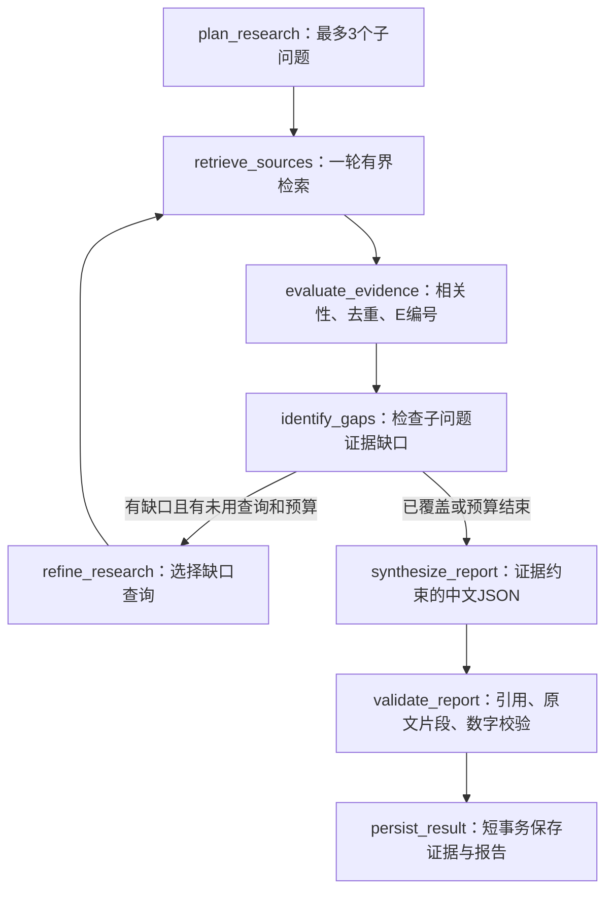

# Sprint 4：有界 LangGraph Deep Research

最新结构化报告代码说明见 [报告契约与安全字段诊断](22-RESEARCH-REPORT-CONTRACT.md)。当前 Prompt v6 仅离线通过，最后一次真实任务仍为 report_schema_mismatch；本轮没有新增付费任务。

当前记录以 [最终真实复验](21-RESEARCH-FINAL-RECHECK.md) 为准：主体归属 v4 已真实执行，但报告 Schema 校验失败；v5 对局限/评估覆盖的补丁仅离线验证。不能把以下历史参数修复或离线记录当作成功报告验收。

2026-10-23 质量修复：Sprint 6 的真实任务已无截断，但报告为 partial、核心结论为空。现已离线改进主题覆盖、完整有界摘录传递、逐项拒绝诊断和来源警告；Prompt 为 v3。逐条真实证据审查、历史诊断边界及本轮结果见 [Deep Research 质量修复](20-DEEP-RESEARCH-QUALITY.md)。以下首次验收记录保留为历史，不能代表 v3 已通过真实模型验收。

开发库已在 2026-10-22 完成受保护的 `0003 → 0004` 迁移。唯一一次真实验收任务 `10dde09d-e19e-44f5-a0ec-0148379426ed` 保存了 5 条证据和 9 条节点日志，但报告因 `report_output_truncated` 失败。本文已更新报告预算与失败用量统计；本次修复仅做离线验证，没有再次调用模型、连接开发库或修改历史任务。下一次真实研究需要按新预算另行授权，不得重复执行 0004。

文件清单：新增 `src/aipulse/research/{__init__,state,evidence,tools,graph,repository,service}.py`、`src/aipulse/api/research.py`、`src/aipulse/storage/upgrade_dev_research.py`、`alembic/versions/20261021_0004_research_payloads.py`、本说明及 6 个研究/迁移离线测试文件。修改 `models/entities.py`、`api/main.py`、`news/manual_run.py`、`news/cli.py`、`storage/upgrade_dev_summary.py`、`pyproject.toml` 的包注册、08/11 运行文档及必要的 ORM/迁移/Schema 测试。没有新增运行依赖，因此不需要变更 `uv.lock`；已有未提交依赖改动保留。

## 1. 工作流与预算

`src/aipulse/research/graph.py` 使用真正的 LangGraph `StateGraph(ResearchState)`，图状态、输入、证据和输出均经过 Pydantic v2 边界验证。上游 `src/ollama_deep_researcher/` 保持冻结，运行不依赖 Ollama，也不导入上游的 Tavily 搜索执行逻辑。



| 项目 | 硬上限 |
| --- | --- |
| 子问题 | 3 |
| 检索轮数 | 初次 1 轮 + 最多 2 轮补充，共 3 轮 |
| 每轮查询 | 1 个普通文本查询，每个启用来源各请求一页 |
| 每来源每轮结果 | 3 条，本地 + 3 个公开 API 合计最多 12 条候选 |
| 去重证据 | 18 条，每条原始文本最多 2000 字符 |
| 模型调用 | 全任务最多 2 次：计划 1 次、报告 1 次；SDK retries=0 |
| 输出 Token 预算 | 计划 max_tokens=1000，报告 max_tokens=6144，累计预留最多 7144；每次请求前校验 |
| 推理强度 | 计划沿用 DEEPSEEK_RESEARCH_REASONING_EFFORT（默认 max），报告显式 high；thinking 保持 enabled |
| 模型输入 | 主题/关注点有长度上限；报告最多 18×2000 字符已存证据，加有界标题、质量说明、问题映射和原文定位提示 |
| HTTP | 各来源 10 秒 HTTP 超时，来源级总时限 12–15 秒，一轮总时限 20 秒，无翻页和自动重试 |
| 模型单次 | 沿用配置，但研究任务上限 120 秒 |
| 整体任务 | 360 秒，另有有限的失败状态落库时间 |
| LangGraph | recursion_limit=32，终止仍由业务轮数和查询预算控制 |

计划失败时使用原主题形成有限的降级查询，不再重试计划。重复查询不会再检索。没有可用正文摘录时不调用报告模型，只保存明确缺少证据的范围受限结果。模型报告失败时保留已提交证据和脱敏错误状态。

2026-10-22 已核对 [DeepSeek Chat Completions 参数](https://api-docs.deepseek.com/api/create-chat-completion/) 与 [模型限制](https://api-docs.deepseek.com/quick_start/pricing/)：V4 Pro 支持 `high/max`，官方最大输出 393216 Token；应用仍限制单请求最多 8192，报告只用 6144。应用预算不是官方默认值，也不是仅 JSON 正文的长度额度。报告 Prompt 要求概览最多 1 项、结论最多 3 项、每个子问题最多 1 项分析、趋势最多 1 项；每项短述最多 100 字，引用取 12–100 字符的充分原文片段，减少跨栏目重复。原有 Pydantic Schema 与引用、数字校验继续生效，无真实支持的栏目留空。

累计生成预算由 4500 增至 7144，会提高潜在输出费用上限；并不保证一定不会截断。模型单次仍最多 120 秒，两次最多 240 秒；三轮检索各最多 20 秒，整体仍以 360 秒截止。截断不重试、不修补不完整 JSON，继续以 FAILED 保存证据和失败报告。

## 2. 真实检索能力及限制

检索器是可注入的 `SearchProvider` 边界，没有假搜索实现进入生产路径。首次真实验收取得本地新闻 2 条、arXiv 2 条、GitHub 1 条有效证据；本次修复不再执行外部检索，只使用离线替身验证。

| 来源 | 实际获取内容 | 不能声称 |
| --- | --- | --- |
| AIPulse MySQL | 可见 `news_event/news_item/news_source` 的标题、原始摘录、URL、发布时间和已保存抓取时间；支持可选 event_id | 不表示本次重新获取或阅读网页全文 |
| arXiv | 复用现有 `ArxivCollector`，检索相关论文的 API abstract，单页最多 3 条 | 不表示读过 PDF、论文通过同行评审或实验已复现 |
| GitHub | `/search/repositories` 的名称和仓库自述 description | 不表示检查 README、代码、发布功能或性能 |
| Hacker News | Algolia HN Search 的 story title/story_text；来源指向 HN 讨论页 | 不表示抓取或核实被转发文章，标题本身不支持具体事实结论 |

外部来源默认关闭，需 `AIPULSE_ENABLE_RESEARCH_EXTERNAL=1`。未配置付费搜索，不接 Tavily/SerpAPI/Brave。GitHub 可使用已有的可选 `GITHUB_TOKEN`；没有 Token 时使用公开搜索，限流会降级为来源错误，不绕过限制。

只有固定 HTTPS API 地址会被请求。用户与模型均不能指定抓取地址；结果链接仅校验、去重与展示，不访问跳转、不抓网页或 PDF。HTTP 响应类型与大小有界。arXiv 同一实例遵守现有 3 秒请求间隔。公开服务的可用性、限流以及关键词/中英文检索覆盖仍需后续真实验收；覆盖不足必须保留缺口。

实现参考：[LangGraph Graph API](https://docs.langchain.com/oss/python/langgraph/graph-api)、[arXiv API 手册](https://info.arxiv.org/help/api/user-manual.html)、[GitHub Search REST API](https://docs.github.com/en/rest/search/search)、[HN Search API](https://hn.algolia.com/api)。

## 3. 证据与报告的约束

同一规范化 URL、arXiv abs/pdf URL 和同一论文不同版本会去重。HN 转发同一论文时可与该论文候选归为同一来源身份，保留获取内容更充分的一条，并保持 `E001` 等编号稳定。证据有 `source_type/source_id/coverage/quality_note/relevance_note/question_ids`，来源时间缺失保持 null。

证据缺口由子问题的区分词与原始摘录共同判断。v3 对 LangGraph 这样的主题专名要求资料匹配研究对象，子问题匹配使用正文而非标题，通用工具/Agent 词不能替代对象证据。它仍是词汇启发式，不是语义事实核验；标题和仓库元数据不会被升级成充分的原始内容覆盖。报告阶段还检查有效结论/分析所引用证据的子问题覆盖。

模型只生成结构化中文表述。每项研究概览、结论、分主题分析和趋势都需带真实 `citation` 与原文 `quote`。校验会删除编号不存在、仅有标题、原文片段无法匹配、数字超出引文支持或子问题 ID 不存在的表述。报告 URL、标题与关键摘录由后端从证据构造，并在最终落库事务核对引用对应的 `research_evidence` 已保存。

保留的表述统一标为“来源材料称”，不是独立事实裁决。逐字引文、编号和数字校验不能证明中文转述在语义上完全被原文蕴含，也无法自动裁决相互矛盾的来源；报告明确记录这项局限，重要结论需要人工对照引文。没有通过校验的结论就保持空列表，不伪造专业报告。v3 对剔除候选保存有界 `validation_issues`（栏目、索引、文字、supports 和固定原因码），独立有效候选仍保留；这是解析后候选的诊断，不是完整模型原始响应。旧任务没有记录的原候选不能据此补造。

外部材料只存在于有界 JSON data message；固定 system prompt 明确禁止执行其中指令。固定的 JSON schema 示例不嵌入外部正文。工具、条件边、数据库状态和预算均由代码控制。记录请求的主题/关注点、公共证据摘录与验证后的报告；不记录完整模型 Prompt、原始响应、密钥、Authorization 或 reasoning_content。研究图执行期间显式禁用环境中可能开启的 LangSmith tracing，避免外发图状态和模型上下文。对外错误只用固定类别。

## 4. 数据库复用与已完成的 0004 迁移

复用原有三张表，不新增业务表：

- `research_task`：继续用 query、status、started_at/finished_at；0004 增加 `result_json JSON NULL`，保存版本化请求边界、阶段、报告、模型、累计实际 usage、耗时及错误类别。
- `research_evidence`：继续保存 URL、标题、content、citation 和任务外键；0004 增加 `metadata_json JSON NULL`，保存来源身份、质量、时间与相关子问题。
- `agent_run_log`：继续以每任务递增 seq 保存节点、计数和脱敏错误；每次先锁研究任务行再分配 seq。任务详情返回最近 50 条阶段事件。

0004 只有两个 nullable ADD COLUMN，down_revision=`20261021_0003`，没有数据 UPDATE/DELETE，不覆盖旧字段。0001–0003 字节保持不变。新字段使用 deferred ORM 读取，现有新闻/摘要/日报不会隐式加载研究字段。新闻 Schema 检查接受完整 0002/0003/0004；摘要和日报接受完整 0003/0004；研究必须精确为完整 0004。

`upgrade_dev_research` 是已真实执行成功的专用入口，仅允许 `aipulse_migrate@localhost` 在 `127.0.0.1:3306/aipulse_db` 从 0003 升至 0004。它检查 dev 分支、四份 revision 的已固定 SHA-256、迁移操作、外部近期备份、同一 DDL 连接身份和升级前完整 Schema/全表行数，将同一连接交给 Alembic，固定升级至 0004，并复核 Schema 和全部行数。失败只读报告残留 revision，不重试 DDL、不清理或恢复。

### 历史首次升级命令（当前开发库已是 0004，不得重跑）

先停止可能写入新闻/摘要/日报的 Uvicorn，再执行下列命令。密码只在 mysqldump/getpass 的本机提示中输入。

```powershell
Set-Location D:\Projects\AIPulse
$env:PYTHONPATH = 'src'
$researchPython = (Get-Command python).Source
$researchBackupDir = 'C:\Users\<WindowsUser>\Documents\ChatGPT\aipulse\backups'
New-Item -ItemType Directory -Path $researchBackupDir -Force | Out-Null
$researchBackupFile = Join-Path $researchBackupDir ("aipulse_db_before_0004_{0}.sql" -f (Get-Date -Format 'yyyyMMdd_HHmmss'))
if (Test-Path -LiteralPath $researchBackupFile) { throw 'Backup path exists; stop' }
& 'C:\Program Files\MySQL\MySQL Server 8.0\bin\mysqldump.exe' `
  --protocol=TCP --host=127.0.0.1 --port=3306 --user=aipulse_migrate --password `
  --single-transaction --quick --skip-lock-tables --no-tablespaces `
  --set-gtid-purged=OFF --column-statistics=0 --skip-extended-insert `
  --default-character-set=utf8mb4 "--result-file=$researchBackupFile" --databases aipulse_db
if ($LASTEXITCODE -ne 0) { throw 'Backup failed; stop' }
$researchBackupHash = (Get-FileHash -LiteralPath $researchBackupFile -Algorithm SHA256).Hash
Get-Item -LiteralPath $researchBackupFile | Select-Object FullName, Length
& $researchPython -B -m aipulse.storage.upgrade_dev_research --verify-backup `
  --backup-file $researchBackupFile --backup-sha256 $researchBackupHash
if ($LASTEXITCODE -ne 0) { throw 'Backup verification failed; stop' }
& $researchPython -B -m aipulse.storage.upgrade_dev_research `
  --backup-file $researchBackupFile --backup-sha256 $researchBackupHash
if ($LASTEXITCODE -ne 0) { throw 'Migration failed; preserve state and inspect read-only; do not retry' }
```

备份需为项目外的逐行 INSERT 真实数据 dump，SHA-256 完全一致、完成标记有效、不超过一小时、版本为 0003，且所有表的行数与迁移连接上的实时数据一致。需要先单独排查连接时，可在自己的终端运行 `-m aipulse.storage.upgrade_dev_research --diagnose`；该模式只执行 SELECT，不迁移。

## 5. API、生命周期与并发

| 接口 | 行为 |
| --- | --- |
| POST `/api/v1/research/tasks` | 默认关闭；显式启用后返回 202 和 task_id，后台执行，不等待整个图完成 |
| GET `/api/v1/research/tasks/{task_id}` | 状态、阶段、累计预算、证据数、错误类别及最近阶段事件 |
| GET `/api/v1/research/tasks/{task_id}/evidence` | 本任务已持久化的真实证据和引用编号 |
| GET `/api/v1/research/tasks/{task_id}/report` | 已保存结构化中文报告；仍运行时 409，没有报告时 404 |
| POST `/api/v1/research/tasks/{task_id}/cancel` | 需要启用写操作；取消本实例当前任务，返回 202，进入 interrupted |

所有接口限 loopback，拒绝额外查询参数；创建请求只允许 topic、可选 focus/event_id。模型、URL、数据库和工具预算不能由请求更改。GET 不调用模型或检索器，不恢复或改写任务。

任务状态为 queued → running → completed/partial/failed，取消或进程中断为 interrupted。同一实例只接收一个任务，忙时 409，没有无界内存队列。节点提交采用短事务；HTTP/LLM 调用不持有 Session 或数据库锁。模型失败、取证失败、总超时和取消均释放执行槽，已提交的证据保留。

任务不是可持久化恢复的 LangGraph checkpoint。正常关闭会取消任务并尽力写入 interrupted；硬退出或数据库不可用时，后续 GET 将本实例不再持有的 queued/running 任务呈现为 interrupted，避免永久显示 RUNNING，但 GET 不改数据库。下一次显式启用并创建研究任务时，会先把最多 100 条旧 queued/running 行持久化标记为 interrupted，不会继续付费或自动恢复。重新研究需人工创建新任务 ID。单实例锁不提供跨 worker/跨进程互斥；必须只启动一个 worker。

累计 usage 只相加实际 API 返回的 Token；`usage_missing_calls > 0` 表示部分尝试没有可得 usage，该值不是完整账单，也不会把未知用量伪造为零。进程被硬退出时，最后一次尚未提交的调用统计也可能缺失。任务失败和取消仍可能已产生费用。

收到可解析响应后，Gateway 先提取 usage，再校验结束原因与 JSON。`LLMError` 仅携带类别、可用 usage、耗时；截断、非法 JSON 和 Schema 不匹配同样纳入任务累计。`ModelBudget` 在单一 finally 分支中每次只记录一次，缺失/无效 usage 时只增加 `usage_missing_calls`，无任何已知 usage 时 `token_usage=null`。耗时也仅累计一次，不另加异常携带的耗时。不会保存原始响应、Prompt、推理正文或密钥，也不会补写旧任务未知用量。

报告 GET 保持 HTTP 200 的已有读取契约，HTTP 成功只表示读取成功。客户端必须检查 `status`：`failed` 时展示 `error_code` 和局限，不能显示“报告生成成功”；`partial` 必须标注不完整。新报告增加可空 `error_code`。旧报告缺少此字段时，仅在 GET 响应中从任务错误类别补出，不更新数据库。新报告 Prompt 版本为 `research-zh-v3`，历史 v1/v2 与用量记录保持原样。新增 `source_warnings`、`validation_issues` 均兼容缺省；可选来源警告不会单独阻止有有效核心结论且覆盖充分的报告 completed，但警告会保留并展示。完全没有证据和可用内容时为 failed，有部分资料但核心报告不足仍为 partial。

## 6. 后续真实研究：另行批准后单次验收

当前 0004 已应用，无需迁移。下一次需明确批准：一次新 POST 写入研究表，最多两次 DeepSeek 调用，计划 1000 / 报告 6144、累计最多 7144 生成 Token 的新预算，以及至多 3 轮公开 API 检索。已有 `.env` 保持不变；使用研究模型 `deepseek-v4-pro`，计划沿用配置默认 `max`，报告显式 `high`。本次修复没有执行这些真实操作。

```powershell
Set-Location D:\Projects\AIPulse
$env:PYTHONPATH = 'src'
$env:AIPULSE_ENABLE_RESEARCH = '1'
$env:AIPULSE_ENABLE_RESEARCH_EXTERNAL = '1'
$env:AIPULSE_ENABLE_SCHEDULED_COLLECTION = '0'
$env:AIPULSE_ENABLE_MANUAL_COLLECTION = '0'
$env:AIPULSE_ENABLE_AI_SUMMARY = '0'
$env:AIPULSE_ENABLE_DAILY_BRIEF = '0'
python -B -m uvicorn aipulse.api.main:app --host 127.0.0.1 --port 8000 --workers 1 --no-proxy-headers
```

在 `http://127.0.0.1:8000/docs` 的 POST 提交，例如：

```json
{"topic":"LangGraph 的状态管理与研究工作流","focus":"公开方法、适用范围与证据局限"}
```

返回结构为 `{"task_id":"<实际生成的 UUID>","status":"queued"}`。此处是格式示例，不是真实任务结果。之后轮询任务详情，终态后读取 evidence 和 report，核对每个 E 编号及 support_quotes 是否确实存在；报告可能为 partial，这代表覆盖不足或部分失败，不应包装成完整事实验证。通过 GET 再次读取不会产生模型费用。验收结束后关闭 Uvicorn。

## 7. 离线验证边界

测试使用 Fake LLM、MockTransport、记录型 Session 和受控证据，覆盖实际 StateGraph 节点/条件边、轮数与调用预算、空证据、重复查询、原文引用、Prompt Injection、HTTP 错误与大小限制、短事务持久化、任务状态、取消/超时/锁释放、REST 开关和旧路由。没有调用真实新闻检索接口、模型、开发库或测试库。

2026-10-21 离线结果：研究模块、受保护迁移入口、ORM/迁移契约及现有新闻/摘要/日报兼容性定向检查共 **141 passed**；冻结上游 Mock 检查 **2 passed**；`pip check` 通过。存在一条现有 Starlette TestClient 关于 httpx 的弃用提示，不影响本次通过结果。未执行全量 pytest。

真实迁移、任务落库与 GET 查询已经验收；完整报告生成因截断尚未通过。此次新参数的线上效果仍待下一次单独授权的真实验收，不能以离线通过代替。

### 截断与用量修复的定向离线验证

仅运行 Gateway、Research Graph、Recorded Session 持久化和 Research API 四个文件，共 **59 passed**。覆盖正常 JSON、截断有/无 usage、不完整 JSON、Schema 不匹配、两次调用累计、第三次/超预算拒绝、引用有效性、失败证据及日志保留、释放运行槽、任务时限、旧失败报告 GET 的错误语义。存在原有 Starlette/httpx 弃用提示。命令使用固定 Conda Python，无真实数据库或模型调用：

```powershell
Set-Location D:\Projects\AIPulse
$env:PYTHONPATH = 'src'
python -B -m pytest -q -p no:cacheprovider `
  tests/aipulse/unit/test_llm_gateway.py tests/aipulse/unit/test_research_graph.py `
  tests/aipulse/unit/test_research_persistence.py tests/aipulse/unit/test_research_api.py
```
