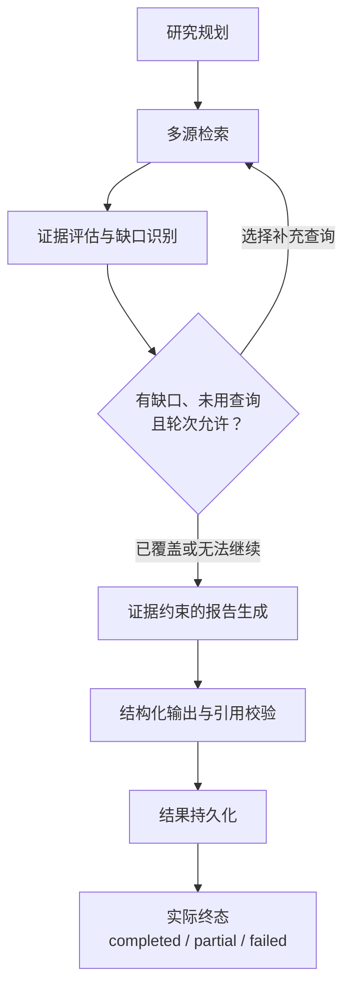
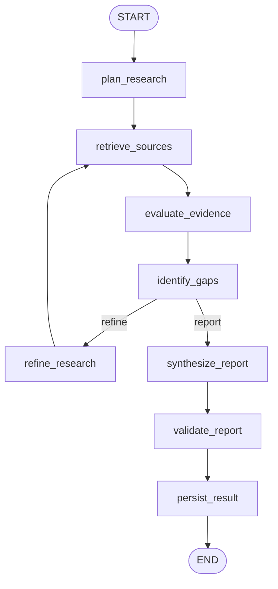

# LangGraph Deep Research：当前实现与边界

2026-10-26 源码核对：`research/graph.py`、`state.py`、`evidence.py`、`service.py`。当前 Prompt 为 `research-zh-v6`。有真实执行及证据保存记录，但 **v6 完整成功报告尚未真实模型验收**。本轮不运行模型、公开检索或数据库。

## 1. 展示版流程

预算耗尽不意味着成功：没有充分覆盖或有效核心结论仍可为 partial；格式、执行或持久化的致命错误可为 failed。外层任务时限可能打断任何阶段，而不是超时后继续生成。

## 2. 实际 StateGraph

以上八个节点、START/END 与边均来自 `ResearchWorkflow.__init__`，没有为了展示修改图运行逻辑。

| 节点 | 实际职责 |
| --- | --- |
| plan_research | 一次受限 JSON 规划；失败时用原主题降级查询，不额外付费重试 |
| retrieve_sources | 一轮有界并行检索；记录查询和来源错误，重复查询不再请求 |
| evaluate_evidence | 来源身份去重、稳定 E 编号、相关性与主体归属/问题覆盖分离 |
| identify_gaps | 检查缺口与停止原因：coverage_sufficient、round_budget、no_new_query |
| refine_research | 选择缺口对应的未使用查询，递增 supplements，不调用模型 |
| synthesize_report | 把有界原始片段和问题—证据映射传给模型；无可用摘录时不请求报告 |
| validate_report | Pydantic 草稿转换、逐项引文/编号/数字校验、真实终态与拒绝诊断 |
| persist_result | 通过回调以短事务保存最终证据、报告和实际 metrics |

`_route` 仅当 **有 gaps、rounds < 3、supplements < 2、仍有未使用的缺口查询** 时返回 refine，否则进入 report。它不直接检查墙钟或声称覆盖一定充分。360 秒截止由 `ResearchExecutor._execute` 的 `asyncio.timeout` 在图外保证；超时、取消或异常时由 Executor 有界写入终态，释放槽位，不强行走完报告节点。

## 3. 硬预算与生命周期

| 项目 | 源码约束 |
| --- | --- |
| 子问题 | 最多 3 个 |
| 检索 | 最多 3 轮（初次 + 2 次补充），每来源每轮 3 条候选，单页 |
| 证据 | 最多 18 条，每条已存文本最多 2000 字符；不是网页或论文全文 |
| 模型调用 | 最多 2 次（规划、报告），调用前预留预算；业务 Gateway retries=0 |
| 输出 Token | 规划 1000 + 报告 6144 = 7144；输入另计，不是金额上限 |
| 推理强度 | 规划沿配置，报告显式 high；不保存 reasoning_content |
| 时限 | 每轮检索 20 秒，模型每次最多 120 秒；核心任务截止 360 秒，终态写入另有界 |
| 图执行 | recursion_limit=32；业务轮次/查询和 Executor 截止仍是主要边界 |
| 并发 | 一个进程内最多 1 个任务，无队列；必须单 worker，无跨进程互斥 |

正常状态为 queued → running → completed / partial / failed，取消或中断表现为 interrupted。提交先检查 Schema 与配置，再写任务并启动有界后台执行器。HTTP / 模型等待不持有数据库事务或行锁。

节点前的 progress 回调保存进度，最终回调保存结果；已提交的证据不会因可选来源失败而丢弃。GET 读取不重新执行模型，不继续付费任务。进程中断后的读取可以呈现 interrupted，下一次显式创建时有界标记旧活动记录，但**不恢复原图**。没有 LangGraph Checkpointer 或跨进程 checkpoint 续跑。

## 4. 来源与证据

| 来源 | 真正读取的材料 | 不能宣称 |
| --- | --- | --- |
| 本地新闻 | 已存标题、摘录、来源 URL、时间，可限定 event_id | 本次重新阅读全文 |
| arXiv | API abstract | 读过 PDF、复现实验或同行评审通过 |
| GitHub Search | 仓库名称、自述 description | 已审查代码、README 或性能 |
| HN Search | 讨论标题、story_text | 已阅读全文或核实转发内容 |

外部来源仅在 `AIPULSE_ENABLE_RESEARCH_EXTERNAL=1` 时启用；只有固定 HTTPS API，结果 URL 用于展示和身份去重，不跟随抓取。GitHub rate limit 后停止该任务此来源后续请求，其他来源继续，警告独立保留。

相关材料可以作为背景，只有明确归属于研究对象的主体—技术行为片段才能覆盖对应问题。比较名称、其他框架能力、模糊代词或缺失主语不自动覆盖；保守规则可能漏判，不是完整语义推理。能力描述不能自动回答“局限 / 评估”问题。

模型看到稳定 E 编号、完整有界片段、question_evidence 与 coverage_supports。外部内容是不可信数据，固定 system 规则不执行其中指令；图的工具、URL 和预算不能由模型改变。逐字引文只证明可追溯，不能证明中文结论完全被原文蕴含，不能取代人工核验。

## 5. 报告契约、终态与诊断

模型生成 `ReportDraft`，后端生成 `ResearchReport`，不是两套相互冲突的模型输出契约。Gateway 使用 JSON Output + 同一 Pydantic 类校验，报告转换增加真实来源、状态、模型及用量；不靠补造结论或证据来修复结构错误。[v6 字段与安全诊断](22-RESEARCH-REPORT-CONTRACT.md)

- **completed**：有通过校验的核心结论、足够覆盖，无未解决缺口、阻断错误或被剔除候选。可以保留明确的可选来源警告。
- **partial**：已有可用材料，但核心结论、覆盖或完整度不足，或存在被剔除候选。独立有效结论仍保留。
- **failed**：必要报告生成/转换失败，完全无可用结果，或执行器遇到致命执行、时限、持久化错误。

Schema 失败保留固定 report_schema_mismatch，记录阶段及脱敏 loc/type；不记录原始 input 值、完整响应、Prompt 或内部推理。引用失败逐项记录有界候选及固定原因码，不把 Schema 错误冒充引用错误。

usage 在有效响应到达后尽早提取，ModelBudget 的单一 finally 每次累计一次，包括已知 usage 的失败调用。没有 usage 就增加 usage_missing_calls；没有任何已知用量时 token_usage 为 null，不补零。失败和取消仍可能计费。

## 6. API 与运行

| 接口 | 行为 |
| --- | --- |
| POST `/api/v1/research/tasks` | 开关开启且本机请求才创建；返回 202 / task_id |
| GET `/api/v1/research/tasks/{task_id}` | 状态、阶段、预算及最近节点事件 |
| GET `/api/v1/research/tasks/{task_id}/evidence` | 本任务已保存证据 |
| GET `/api/v1/research/tasks/{task_id}/report` | 已存报告；HTTP 200 仍须检查业务 status |
| POST `/api/v1/research/tasks/{task_id}/cancel` | 取消本实例任务，进入 interrupted |

研究必须是完整 0004 Schema。使用现有 research_task / research_evidence / agent_run_log，result_json、metadata_json 保存结构化载荷，不新增表。当前受保护迁移已无 dev 分支或个人解释器要求，四份 revision 保持固定 SHA-256。[部署与备份](15-LOCAL-DEPLOYMENT.md)

所有开关默认关闭；使用 loopback、单 worker、无 reload，并保留 Host/Origin 保护。本轮不提供可误执行的真实研究 POST，后续付费验收由操作者明确选择预算。离线验证、Demo Data 截图及 CI 范围见 [工程质量](25-ENGINEERING-QUALITY.md)，历史失败边界见 [21](21-RESEARCH-FINAL-RECHECK.md)。
